# Trails Save Editor

**English** · [Russian](README_RU.md)

Save editors for **The Legend of Heroes: Trails** on PC (Steam). Pick a game, pick a save slot, change what you
need and write it back — the editor shows everything the way the game does (item icons, character portraits,
enemy pictures, the game's own names and categories) and recalculates the save checksum, so the game loads the
edited save as its own.

| Program | Games | Saves |
|---|---|---|
| **SE-Calvard** — `Calvard-SaveEditor.exe` | Trails through Daybreak · Trails through Daybreak II · Trails beyond the Horizon | `Saved Games\Falcom\Kuro`, `Kuro2`, `Kai` (`user.dat`) |
| **SE-Crossbell** — `Crossbell-SaveEditor.exe` | Trails from Zero · Trails to Azure | `Saved Games\Falcom\Zero`, `Ao` (`savedata.dat`) |

## Contents

- [Download and run](#download-and-run)
- [SE-Calvard](#se-calvard)
- [SE-Crossbell](#se-crossbell)
- [Saving and backups](#saving-and-backups)
- [Keyboard and mouse](#keyboard-and-mouse)
- [Good to know](#good-to-know)
- [Building from source](#building-from-source)
- [License](#license)

## Download and run

1. Download the archive for your games from [Releases](../../releases) and unpack it anywhere.
2. Keep `data.dat` next to the exe — it holds the item icons, portraits, enemy pictures and game tables.
   Without it the editor can't show items, characters or enemies.
3. Start the editor and choose the game by its cover. The save folder is found automatically
   (`C:\Users\<name>\Saved Games\Falcom\…`); «Browse…» picks another folder, and a save file can also be dropped
   onto the window.
4. Select a slot on the left — chapter, location and play time are shown for every slot.
5. Make your changes and click **Save to this slot** or **Save to new slot**.

Close the game or return to its title screen before writing — the game keeps its slots open.

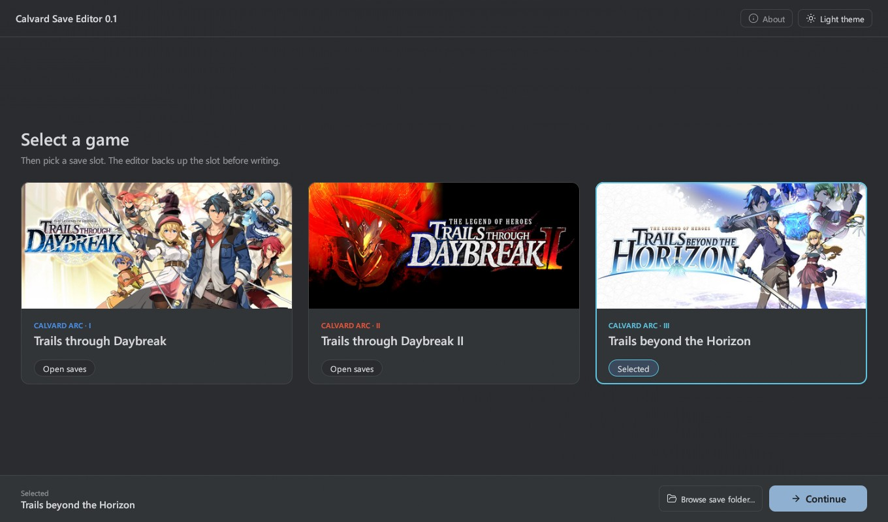

## SE-Calvard

Trails through Daybreak, Daybreak II and Trails beyond the Horizon — one program, the game is chosen on start.

### General

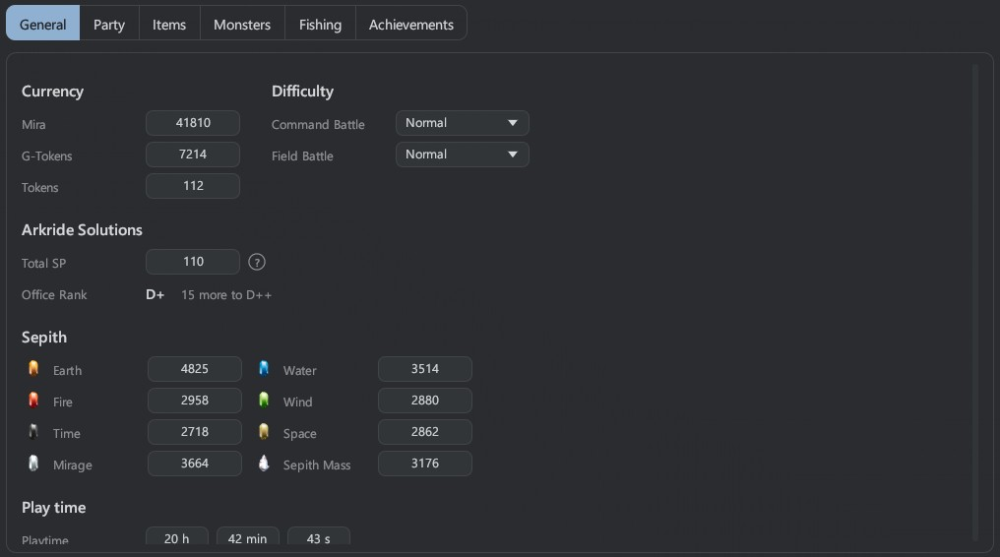

- **Currency** — mira, G-Tokens and tokens.
- **Difficulty** — Command Battle (Very Easy … Nightmare) and Field Battle (Easy … Hard).
- **Arkride Solutions** — Total SP and the Office Rank. The rank is calculated from SP exactly as in the game, with
  the points left to the next rank.
- **L.G.C.** — the Law, Gray and Chaos gauges with their levels.
- **Sepith** — Earth, Water, Fire, Wind, Time, Space, Mirage and Sepith Mass.
- **Play time** — hours, minutes, seconds.

### Party

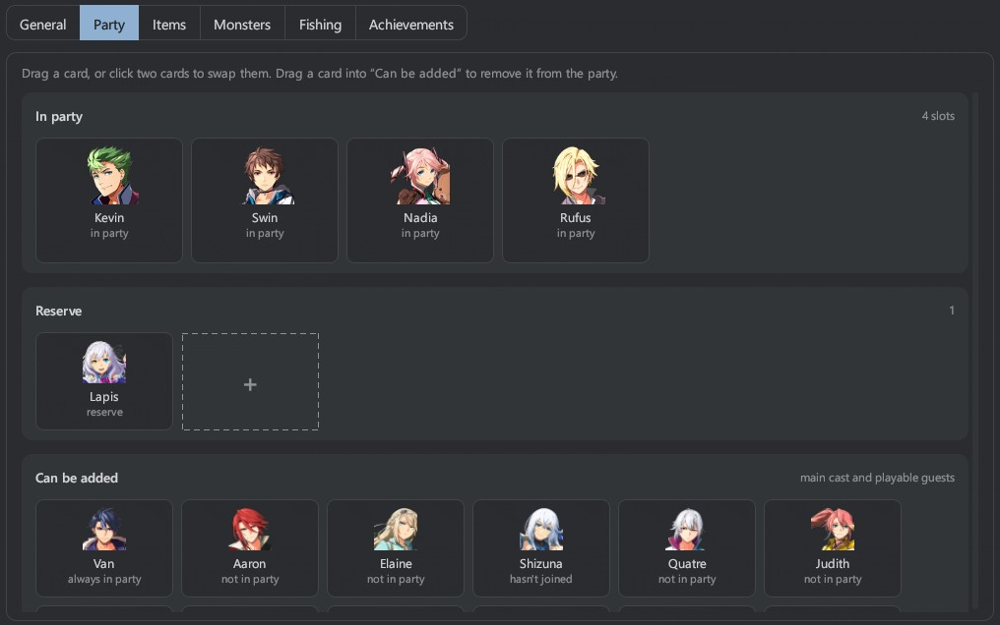

Three zones of character cards: **In party** (4 battle slots), **Reserve** and **Can be added**.
Drag a card onto another one, or click two cards, to swap them; click a card and then an empty «+» slot to move it.
Dropping a card into *Can be added* removes the character from the party. Van can't be removed.

### Items

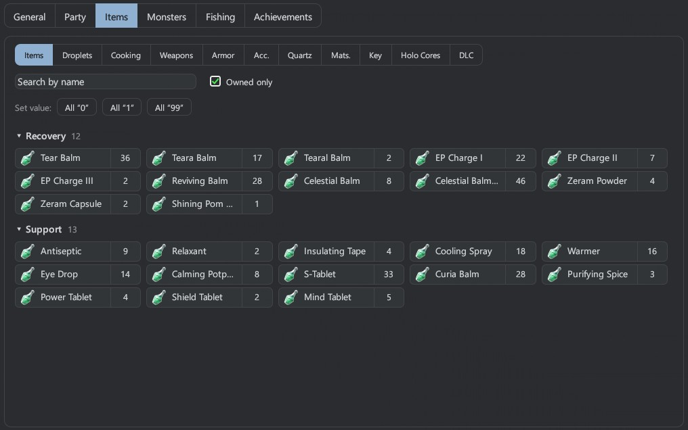

Every item with its icon and amount, in the game's own categories: Items, Droplets, Cooking, Weapons, Armor,
Accessories, Quartz, Materials, Key, Holo Cores and DLC, split into the game's sections.

- Search by name; click a name for the item's description.
- Untick **Owned only** to see every item and add the ones you don't have.
- **All "0" / "1" / "99"** — set the amount of all visible items at once.
- Internal game entries (spare slots, debug and guest gear, marked ◆) are hidden; *About → Show internal items*
  shows them.

### Monsters

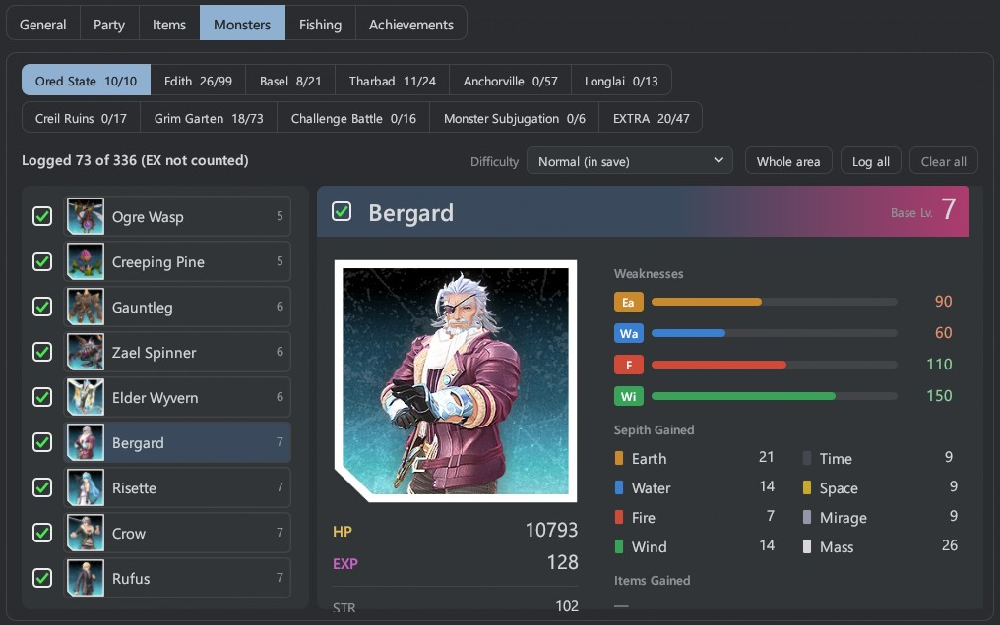

The enemy log by area, laid out like the game's Battle Record but on one page instead of two:

- on the left — the area's enemies with portraits, Base Lv and a tick for «logged»;
- on the right — the enemy card: portrait, Base Lv, **HP, EXP, STR, DEF, ATS, ADF, SPD**, elemental weaknesses
  (Time, Space and Mirage too where the game shows them), sepith gained and items gained with their drop rates.
  Bosses have the pink banner, as in the game.

The numbers follow the game's own formulas for the **difficulty** selected above the list (the save's difficulty
by default) — they were checked against the in-game Enemy Data screens. Ticking an enemy logs it; the enemy log
achievements and their counter are updated along with it. «Whole area», «Log all» and «Clear all» work on many
enemies at once.

### Fishing

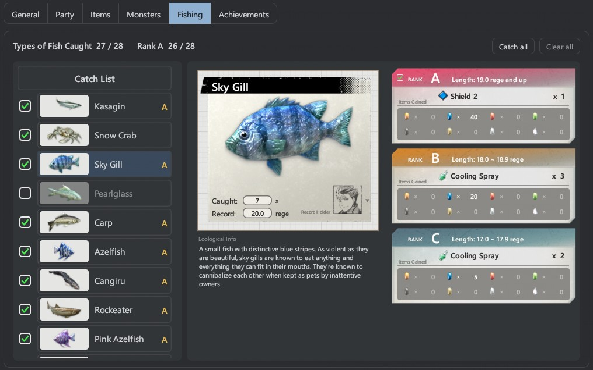

Daybreak II and Horizon: the fishing notebook. For every fish — caught or not, rank A, the record length and how
many were caught; the first page shows the fishing gear and the whole notebook. The game derives rank A from the
record, the editor follows the same rule.

### Achievements

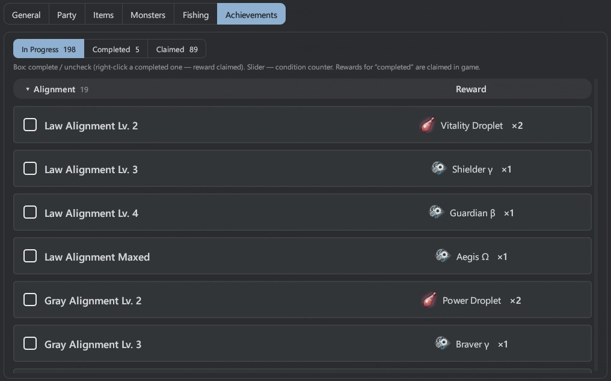

Like the game's Reward screen: **In progress**, **Completed** and **Claimed**, grouped by section, with counters
and rewards. Click the box to complete an achievement or to uncheck it; right-click a completed one to mark its
reward as claimed (the reward itself is collected in the game).

## SE-Crossbell

Trails from Zero and Trails to Azure.

### General

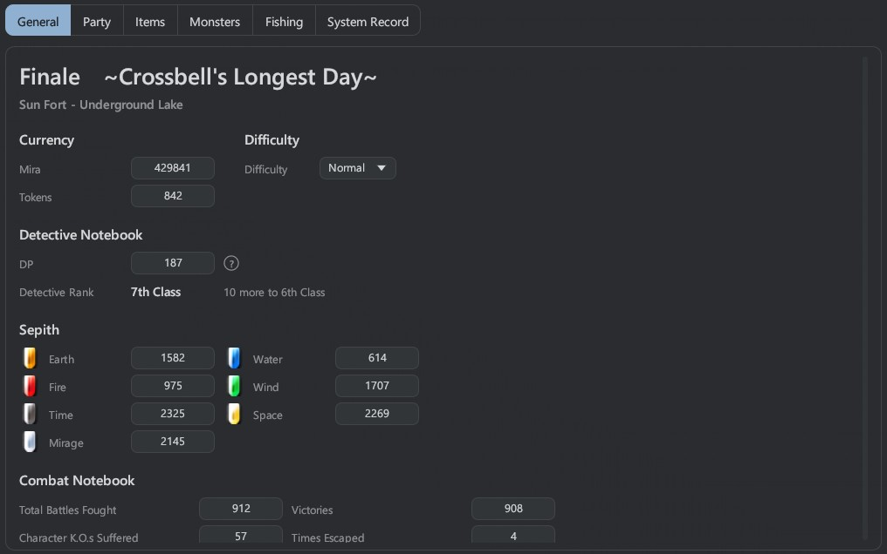

- **Mira** and **tokens**.
- **Detective Notebook** — DP and the detective rank, calculated from DP.
- **Sepith** — Earth, Water, Fire, Wind, Time, Space and Mirage.
- **Combat Notebook** — battles fought, victories and the other counters.
- **Play time** and **difficulty**.

### Party

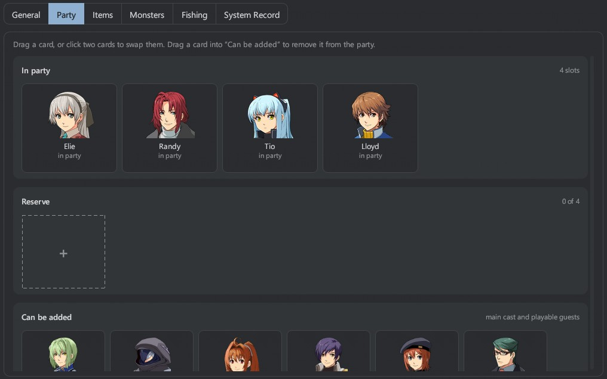

**In party** (4 slots), **Reserve** (up to 4) and **Can be added** (characters who have joined), with the same
drag-and-drop as in SE-Calvard. Guests (KeA, Renne…) are added and removed by the story.

### Items

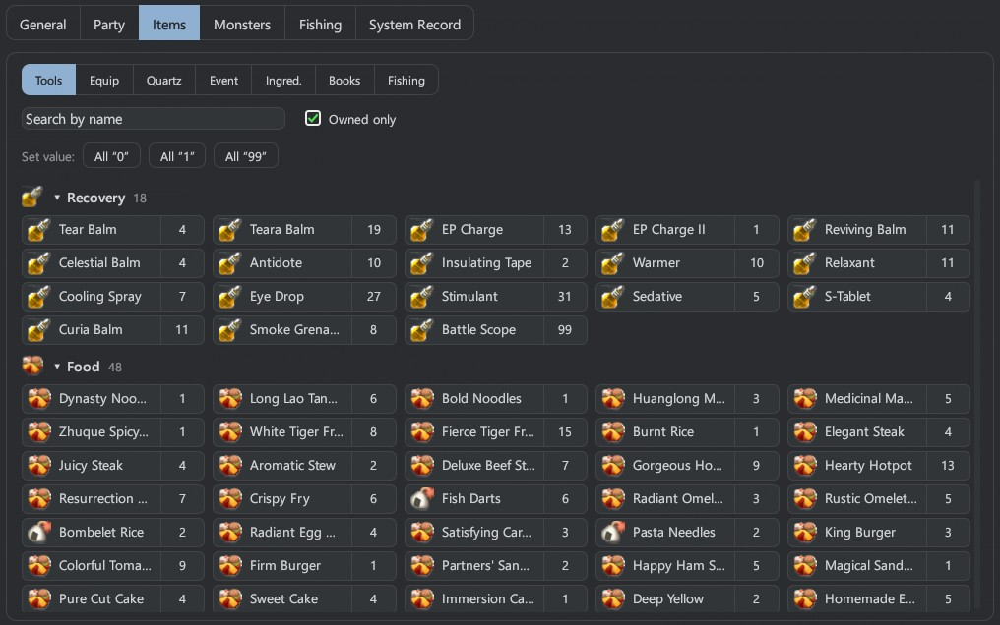

Every item with its icon and amount in the game's categories, search by name, descriptions, **Owned only** and
**All "0" / "1" / "99"**.

### Monsters

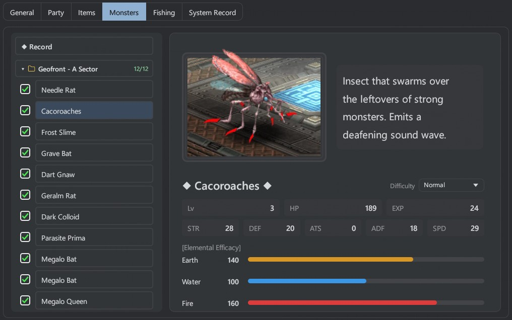

The Combat Notebook by area: the enemy's picture and description, level, HP, EXP, STR, DEF, ATS, ADF, SPD and
elemental efficacy for the difficulty you pick. A tick — the entry is fully logged, a dash — a partial entry.

### Fishing

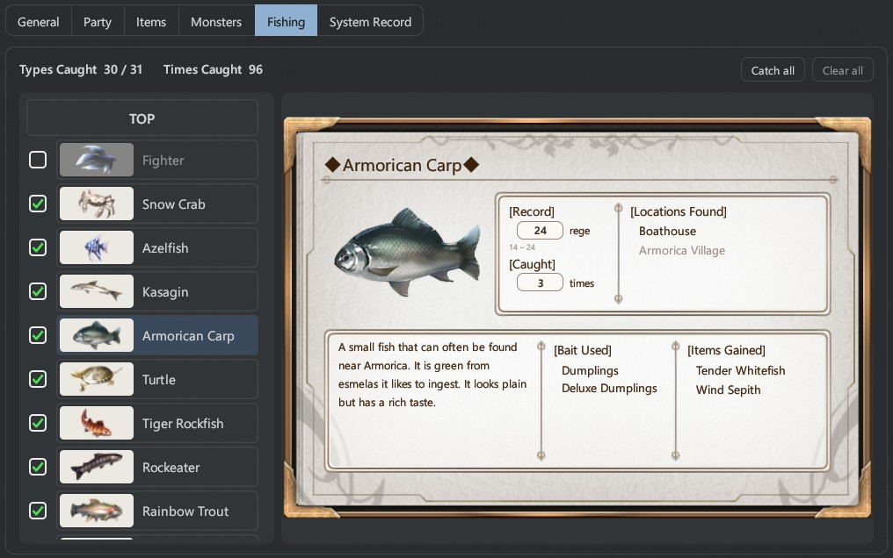

The Fishing Note: what is caught, the record and how many times; pale text tells where and with what bait the fish
is caught. Trails to Azure also has the TOP page with the fishing duel medals — a medal is both the duel victory
and the item.

### System Record

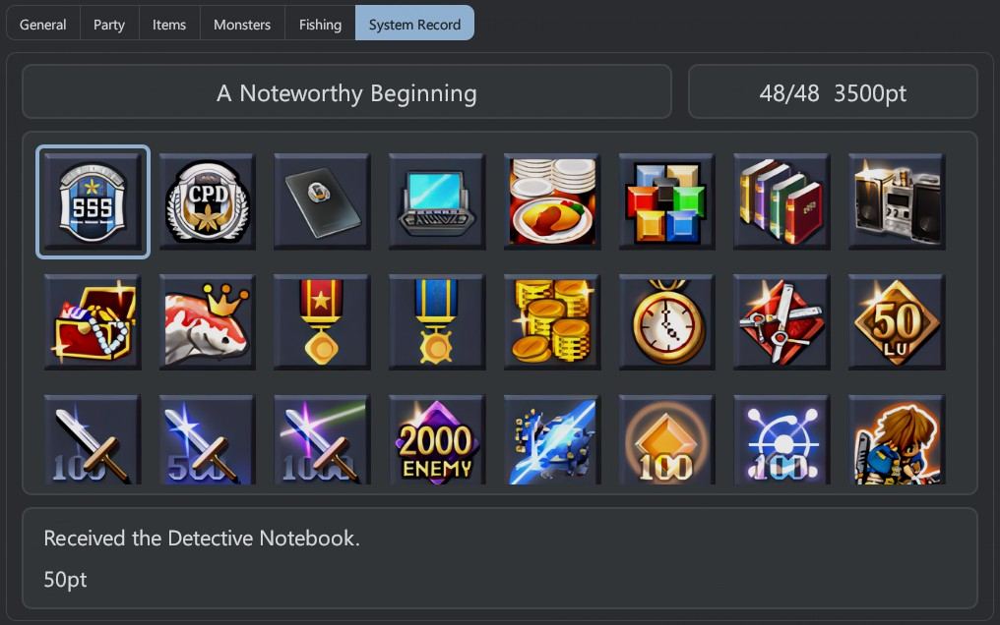

The game's records: click an icon to obtain or remove it; hover it for its name and description.

## Saving and backups

- **Save to this slot** writes the changes into the selected slot.
- **Save to new slot** writes the edited save into a slot you choose; an occupied slot is overwritten.
- **Discard changes** returns everything to how it was when the slot was opened.
- Before every write, the slot is copied to the **`Backups`** folder next to the program (*About* opens it), so
  any slot can be restored by copying it back.
- The checksums are recalculated, and the written file is read back and compared before the editor reports success.

## Keyboard and mouse

| Key | Action |
|---|---|
| Ctrl+S | Save to this slot |
| Ctrl+F | Search across all tabs |
| Up / Down | Previous / next slot |
| Ctrl + mouse wheel | Zoom the window |

Light and dark theme — the button at the top right. Short tips are shown on the first start (*Tips* shows them
again).

## Good to know

- These are unofficial fan tools. Keep your own copies of your saves.
- Adding characters, items or story-only gear far ahead of the story can confuse the game (missing models, empty
  weapon slots). Try such edits on a new slot first.
- Daybreak doesn't store Total SP — it adds it up from completed quests; the editor writes the difference into the
  quests' bonuses, so SP can't change before the first quest is completed.
- Trails from Zero and Trails to Azure load models per story chapter: a character who isn't in the party at this
  point of the story may appear with someone else's model.

## Building from source

You need Windows, [Rust](https://rustup.rs) 1.88 or newer (edition 2024) and Visual Studio Build Tools (the C++
compiler and the Windows SDK — for the exe icons).

```
cargo build --release
```

`Calvard-SaveEditor.exe` and `Crossbell-SaveEditor.exe` end up in `target\release`.
The repository contains no game data: put `data.dat` from a release archive next to the exe.

`src/calvard/save.rs` and `src/crossbell/ed7save.rs` describe the save formats (offsets, checksums, compression);
the windows are in `src/calvard_save_main.rs`, `src/crossbell_save_main.rs` and the shared `src/gui_common.rs`.

## License

The code is released under the [MIT License](LICENSE).

The button icons (`src/icons/*.svg`, except `calvard_save.svg` and `crossbell_save.svg`) are from
[Lucide](https://lucide.dev) and are licensed under the ISC License — see `src/icons/LICENSE`.

The Legend of Heroes, Trails through Daybreak, Trails beyond the Horizon, Trails from Zero and Trails to Azure
are trademarks of Nihon Falcom Corporation. This project is not affiliated with or endorsed by Nihon Falcom.
The item icons, portraits, enemy pictures and game texts in `data.dat` belong to Nihon Falcom and are not covered
by the MIT License.
