# Trails Save Editor

[English](README.md) · **Русский**

Редакторы сохранений для **The Legend of Heroes: Trails** на ПК (Steam). Выбираете игру и слот, меняете что нужно и
записываете обратно. Редактор показывает всё так же, как игра (значки предметов, портреты персонажей, рисунки врагов,
названия и разделы из самой игры), и пересчитывает контрольную сумму — игра загружает изменённое сохранение как своё.

| Программа | Игры | Сохранения |
|---|---|---|
| **SE-Calvard** — `Calvard-SaveEditor.exe` | Trails through Daybreak · Trails through Daybreak II · Trails beyond the Horizon | `Saved Games\Falcom\Kuro`, `Kuro2`, `Kai` (`user.dat`) |
| **SE-Crossbell** — `Crossbell-SaveEditor.exe` | Trails from Zero · Trails to Azure | `Saved Games\Falcom\Zero`, `Ao` (`savedata.dat`) |

Интерфейс программ — на английском.

## Содержание

- [Скачать и запустить](#скачать-и-запустить)
- [SE-Calvard](#se-calvard)
- [SE-Crossbell](#se-crossbell)
- [Запись и резервные копии](#запись-и-резервные-копии)
- [Клавиатура и мышь](#клавиатура-и-мышь)
- [Полезно знать](#полезно-знать)
- [Сборка из исходников](#сборка-из-исходников)
- [Лицензия](#лицензия)

## Скачать и запустить

1. Скачайте архив для своих игр в [Releases](../../releases) и распакуйте куда угодно.
2. `data.dat` должен лежать рядом с exe: в нём значки предметов, портреты, рисунки врагов и таблицы игр. Без него
   редактор не покажет предметы, персонажей и врагов.
3. Запустите редактор и выберите игру по обложке. Папка сохранений находится сама
   (`C:\Users\<имя>\Saved Games\Falcom\…`); «Browse…» — выбрать другую, а файл сохранения можно просто перетащить на окно.
4. Выберите слот слева — у каждого видны глава, место и время игры.
5. Внесите изменения и нажмите **Save to this slot** или **Save to new slot**.

Перед записью закройте игру или выйдите в её главное меню — игра держит слоты открытыми.

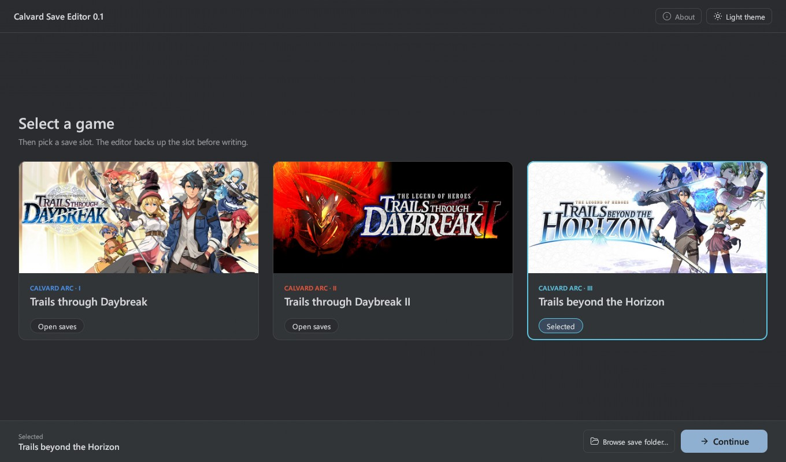

## SE-Calvard

Trails through Daybreak, Daybreak II и Trails beyond the Horizon — одна программа, игра выбирается при запуске.

### General — общее

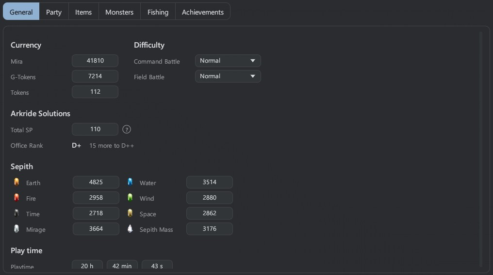

- **Валюта** — мира, G-Tokens и жетоны.
- **Сложность** — Command Battle (Very Easy … Nightmare) и Field Battle (Easy … Hard).
- **Arkride Solutions** — Total SP и ранг конторы (Office Rank); ранг считается по SP так же, как в игре, с остатком
  до следующего.
- **L.G.C.** — шкалы Law, Gray и Chaos с уровнями.
- **Сепит** — Earth, Water, Fire, Wind, Time, Space, Mirage и Sepith Mass.
- **Время игры** — часы, минуты, секунды.

### Party — отряд

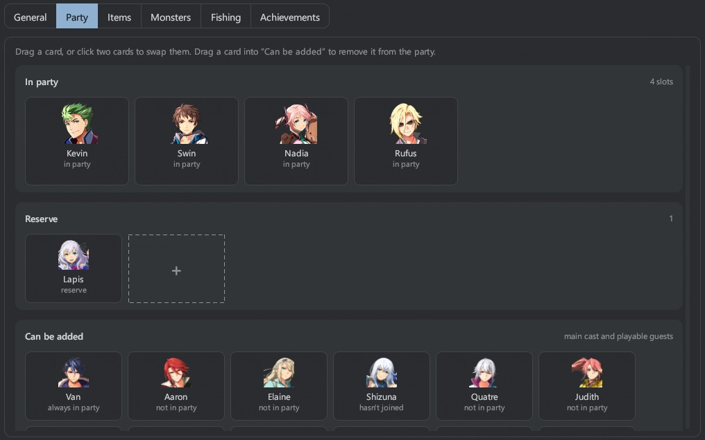

Три зоны карточек: **In party** (4 места в бою), **Reserve** (запас) и **Can be added** (можно добавить).
Перетащите карточку на другую или щёлкните по двум — они поменяются местами; щелчок по карточке и затем по пустому
месту «+» — переставить. Карточка, брошенная в *Can be added*, убирает персонажа из отряда. Вана убрать нельзя.

### Items — предметы

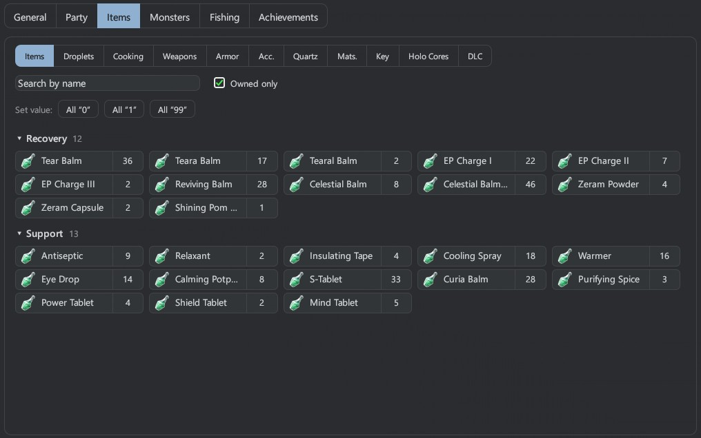

Все предметы со значками и количеством, в разделах самой игры: Items, Droplets, Cooking, Weapons, Armor, Accessories,
Quartz, Materials, Key, Holo Cores и DLC.

- Поиск по названию; щелчок по названию — описание предмета.
- Снимите **Owned only**, чтобы увидеть все предметы и добавить те, которых нет.
- **All "0" / "1" / "99"** — задать количество сразу всем видимым предметам.
- Служебные записи игры (запасные места, отладочное и гостевое снаряжение, значок ◆) скрыты; показать —
  *About → Show internal items*.

### Monsters — журнал врагов

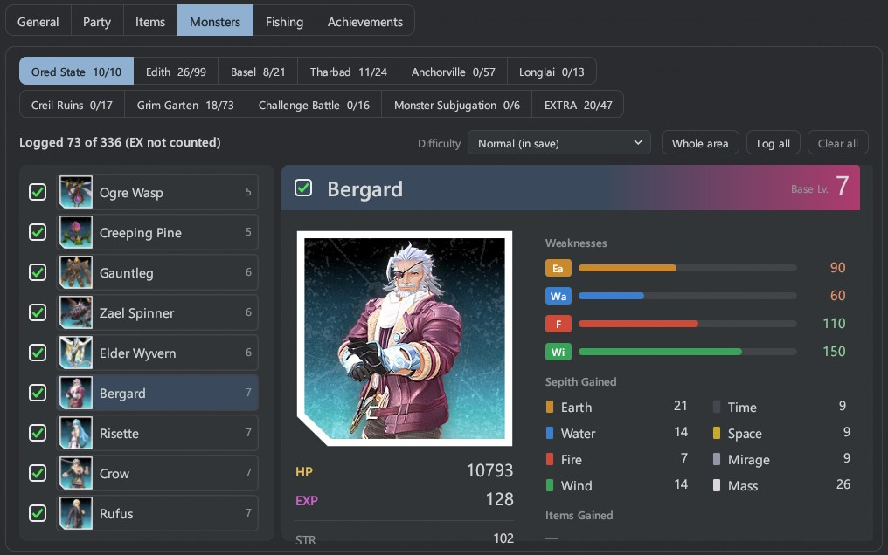

Журнал врагов по местам — как Battle Record в игре, но на одной странице вместо двух:

- слева — враги места с портретами, Base Lv и галкой «записан»;
- справа — карточка врага: портрет, Base Lv, **HP, EXP, STR, DEF, ATS, ADF, SPD**, слабости к стихиям (Time, Space и
  Mirage — там, где их показывает игра), сепит и предметы с шансом выпадения. У боссов — розовая полоса, как в игре.

Числа считаются по формулам игры для **сложности**, выбранной над списком (по умолчанию — сложность сохранения); они
сверены с экранами Enemy Data в игре. Галка записывает врага в журнал; достижения за журнал и их счётчик меняются
вместе с ней. «Whole area», «Log all» и «Clear all» — сразу для многих врагов.

### Fishing — рыбалка

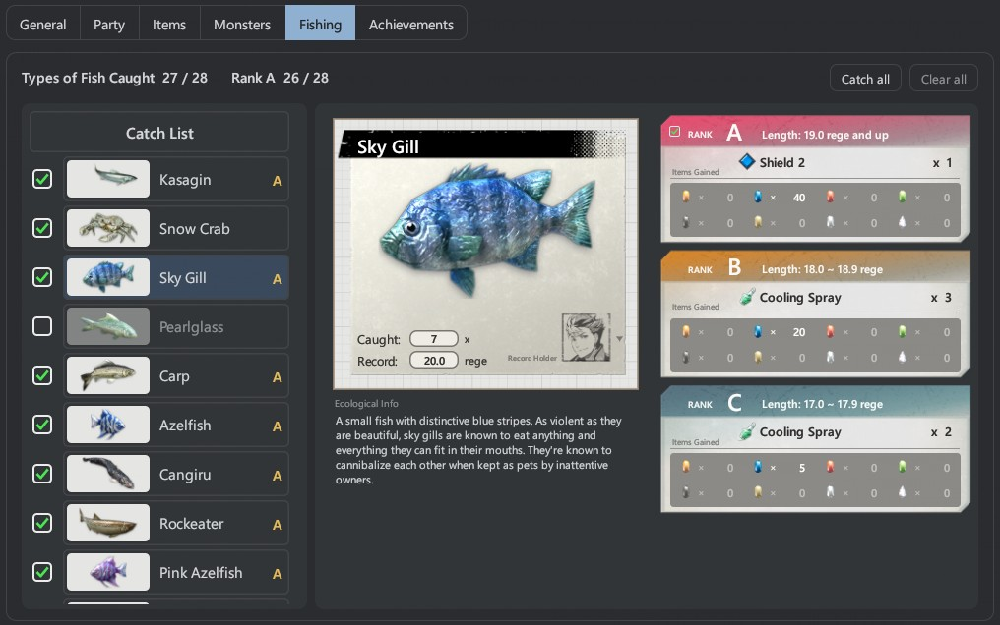

Daybreak II и Horizon: блокнот рыбалки. Для каждой рыбы — поймана или нет, ранг A, рекордная длина и сколько поймано;
на первой странице — снасти и весь блокнот. Ранг A игра выводит из рекорда, редактор следует тому же правилу.

### Achievements — достижения

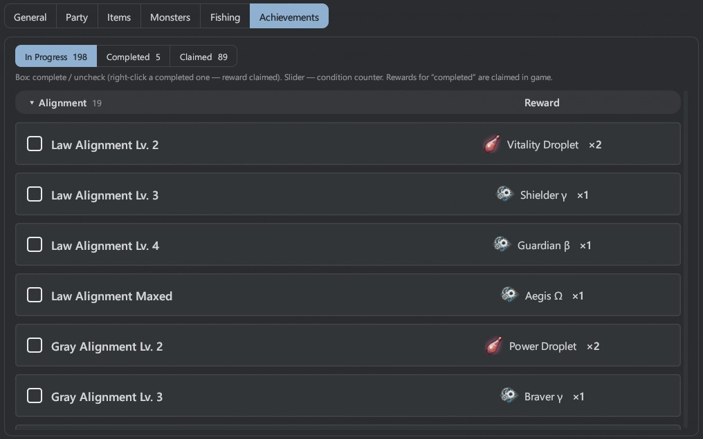

Как экран Reward в игре: **In progress**, **Completed** и **Claimed**, по разделам, со счётчиками и наградами.
Щелчок по квадрату — выполнить достижение или снять отметку; правый щелчок по выполненному — награда забрана (саму
награду забирают в игре).

## SE-Crossbell

Trails from Zero и Trails to Azure.

### General — общее

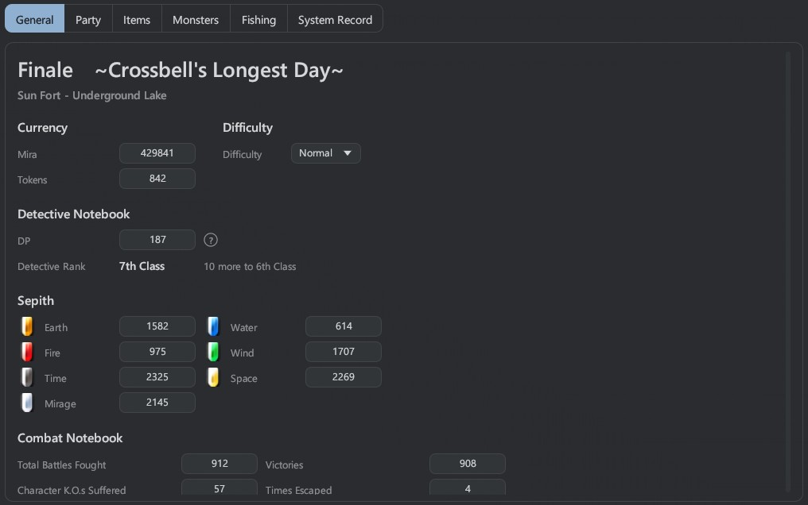

- **Мира** и **жетоны**.
- **Detective Notebook** — DP и ранг детектива (считается по DP).
- **Сепит** — Earth, Water, Fire, Wind, Time, Space и Mirage.
- **Combat Notebook** — проведённые бои, победы и другие счётчики.
- **Время игры** и **сложность**.

### Party — отряд

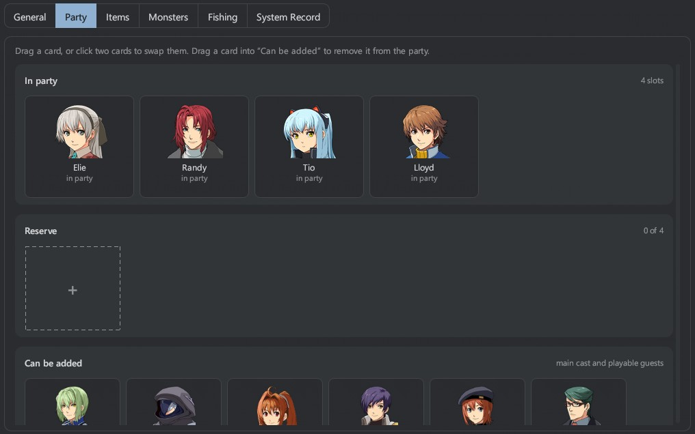

**In party** (4 места), **Reserve** (до 4) и **Can be added** (присоединившиеся персонажи) — перетаскивание так же,
как в SE-Calvard. Гостей (KeA, Ренн…) добавляет и убирает сюжет.

### Items — предметы

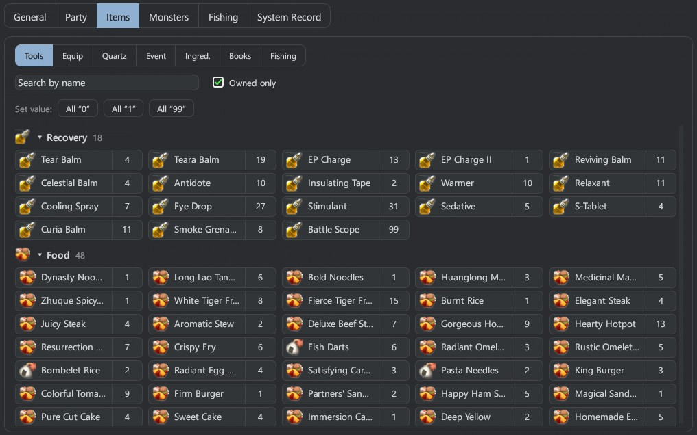

Все предметы со значками и количеством в разделах игры, поиск по названию, описания, **Owned only** и
**All "0" / "1" / "99"**.

### Monsters — журнал врагов

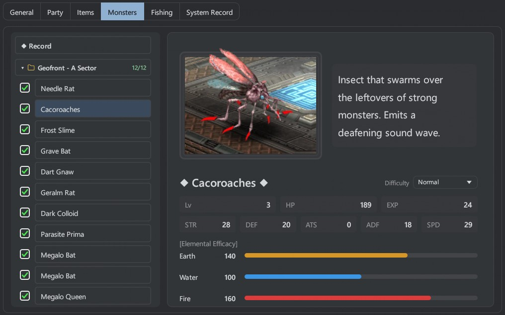

Combat Notebook по местам: рисунок и описание врага, уровень, HP, EXP, STR, DEF, ATS, ADF, SPD и сопротивление
стихиям для выбранной сложности. Галка — запись полная, прочерк — частичная.

### Fishing — рыбалка

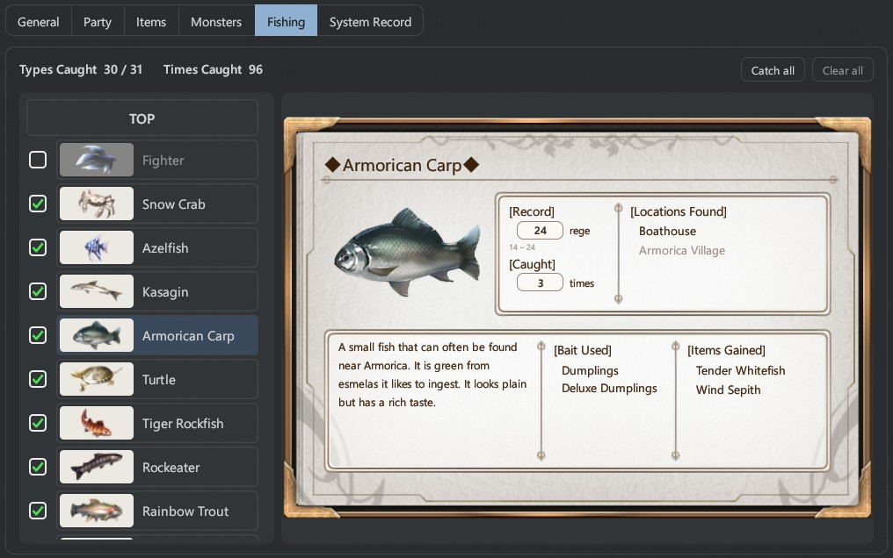

Fishing Note: что поймано, рекорд и сколько раз; бледный текст — где и на какую наживку ловится рыба. В Trails to
Azure есть ещё страница TOP с медалями рыбацких дуэлей — медаль это и победа в дуэли, и предмет.

### System Record — записи

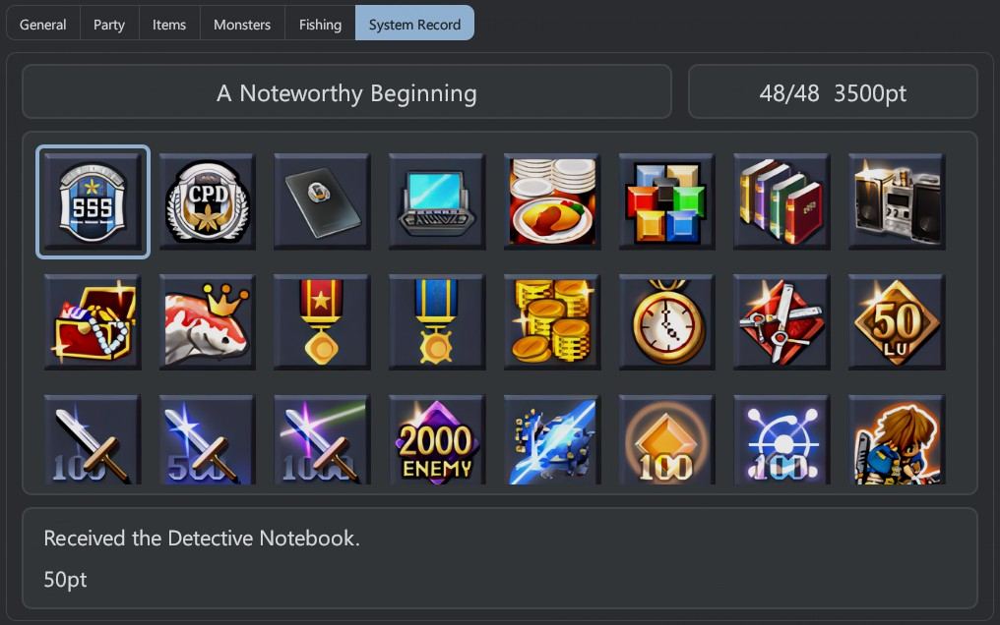

Записи игры: щелчок по значку — получить или убрать; при наведении — название и описание.

## Запись и резервные копии

- **Save to this slot** — записать изменения в выбранный слот.
- **Save to new slot** — записать в слот, который вы выберете; занятый слот перезаписывается.
- **Discard changes** — вернуть всё, как было при открытии слота.
- Перед каждой записью слот копируется в папку **`Backups`** рядом с программой (*About* открывает её) — любой слот
  можно вернуть, скопировав его обратно.
- Контрольные суммы пересчитываются, а записанный файл перечитывается и сверяется, прежде чем редактор сообщит
  об успехе.

## Клавиатура и мышь

| Клавиши | Действие |
|---|---|
| Ctrl+S | Записать в этот слот |
| Ctrl+F | Поиск по всем вкладкам |
| Вверх / Вниз | Предыдущий / следующий слот |
| Ctrl + колесо мыши | Масштаб окна |

Светлая и тёмная тема — кнопка вверху справа. При первом запуске показываются короткие подсказки (*Tips* — показать
снова).

## Полезно знать

- Это неофициальные программы фанатов. Держите свои копии сохранений.
- Персонажи, предметы и сюжетное снаряжение, добавленные сильно раньше сюжета, могут запутать игру (нет модели,
  пустое оружие). Пробуйте такие правки сначала на новом слоте.
- Daybreak не хранит Total SP — игра складывает его из выполненных заданий; редактор записывает разницу в бонусы
  заданий, поэтому до первого выполненного задания SP не меняется.
- Trails from Zero и Trails to Azure загружают модели по главам сюжета: персонаж, которого в этой главе нет в отряде,
  может появиться с чужой моделью.

## Сборка из исходников

Нужны Windows, [Rust](https://rustup.rs) 1.88 или новее (edition 2024) и Visual Studio Build Tools (компилятор C++ и
Windows SDK — для значков exe).

```
cargo build --release
```

`Calvard-SaveEditor.exe` и `Crossbell-SaveEditor.exe` появятся в `target\release`.
Игровых данных в репозитории нет: положите рядом с exe `data.dat` из архива релиза.

Устройство сохранений (адреса, контрольные суммы, сжатие) — в `src/calvard/save.rs` и `src/crossbell/ed7save.rs`;
окна — в `src/calvard_save_main.rs`, `src/crossbell_save_main.rs` и общем `src/gui_common.rs`.

## Лицензия

Код распространяется по [лицензии MIT](LICENSE).

Значки кнопок (`src/icons/*.svg`, кроме `calvard_save.svg` и `crossbell_save.svg`) — из [Lucide](https://lucide.dev),
лицензия ISC — см. `src/icons/LICENSE`.

The Legend of Heroes, Trails through Daybreak, Trails beyond the Horizon, Trails from Zero и Trails to Azure —
товарные знаки Nihon Falcom Corporation. Проект не связан с Nihon Falcom и не одобрен ею. Значки предметов, портреты,
рисунки врагов и тексты игр в `data.dat` принадлежат Nihon Falcom, лицензия MIT на них не распространяется.
